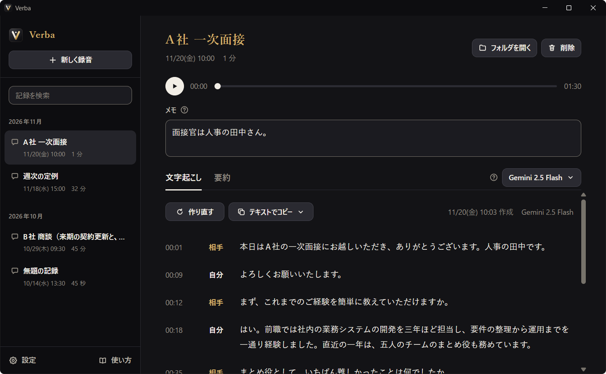

<p align="center"></p>

> *Verba volant, scripta manent.* — 話し言葉は飛び去り、書かれたものは残る。

会話を裏で録音し、Gemini で文字起こしして、終わったあとに要約まで作る Windows 用のデスクトップアプリ。オンライン会議・面接・商談・講義・動画など、パソコンで聞いている会話なら何にでも使える。



- **自分と相手を別々に録る**：マイク（自分）とパソコンの音声出力（相手）を、同時に、別々のトラックに録音する。誰の発話かは、Gemini の聞き分けを二つのトラックの音量で確かめて決める。イヤホンで聞いていても相手の声が録れる。どちらのトラックも、録音の前でも途中でもミュートできる。
- **録りながら、または録り終えてから文字起こし**：録音を発話の切れ目で区切って Gemini に送る（この一区切りを「区間」と呼ぶ）。録音中に約 3 分ごとに送って文字を順に出すか、停止後に約 10 分ずつまとめて送るかを選べる。参加者の名前・用語・案内のメールなどをメモに書いておくと、表記と文脈の手がかりになる。
- **終わったら要約**：概要・要点・決まったこと・次のアクションをまとめる。会話の種類を読み取って書き方を合わせ、面接や商談なら自分の受け答えの振り返りも付ける。
- **記録は PC に保存**：記録は 1 回ごとにフォルダへ保存され、アプリを閉じても残る。録音中にアプリが落ちても、それまでの録音は残り、次回起動時に未処理分の文字起こしを再開する。

## はじめかた

### exe を使う（配布・持ち運び向け）

`Verba.exe` 1 つで動く。Python もインストールも要らない。最新版は [Releases](https://github.com/tomoking2004/verba/releases/latest) から取れる（アプリの左上の「Verba」を押すと開く GitHub のページからも辿れる）。

1. `Verba.exe` を好きな場所（USB メモリでもよい）に置き、ダブルクリックで起動する。
2. 初めて起動すると Gemini の API キーの入力画面が出るので、キーを入れて「登録して始める」を押す（キーは [Google AI Studio](https://aistudio.google.com/apikey) で無料で発行できる）。

記録・設定・API キーはすべて exe の隣の「Verba Data」フォルダに保存され、PC のほかの場所には保存されない。exe とこのフォルダを一緒に移せば、別の PC でも続きから使える。

- **人に渡すとき**：exe だけを渡す。「Verba Data」フォルダには自分の記録と API キーが入っているので渡さない。
- **新しい版にするとき**：exe を新しいものに置き換えるだけでよい。「Verba Data」の記録は、そのまま開ける。ただし、一度新しい版で起動したあとに前の版へ戻すと、開けない記録が出ることがある。使っている版は、設定の窓の左下に出る。
- **起動に数秒かかる**：起動のたびに中身を一時フォルダへ展開するため（USB からだと少し長い）。
- **初回の警告**：署名の無いアプリなので、Windows に「Windows によって PC が保護されました」と出ることがある。「詳細情報」→「実行」で起動できる。
- **必要なもの**：Windows 10 / 11（画面の表示に WebView2 を使う。Windows 11 には最初から入っている）。

### exe を作る（自分でビルドする人向け）

`build.bat` をダブルクリックすると `dist\Verba.exe` ができる。Python 3.12 が必要。ビルド用の仮想環境は、このフォルダが OneDrive の中にあっても同期されないよう、OneDrive の外（`%LOCALAPPDATA%\Verba\build-venv`）に作る。`.env` や記録は exe に含まれない。

### ソースから動かす（開発向け）

1. このリポジトリを取得する。

2. このフォルダの `.env` に Gemini の API キーを書く（書かずに起動すれば、最初に入力画面が出る）。

   ```
   GEMINI_API_KEY=xxxxxxxxxxxxxxxx
   ```

3. `setup.bat` をダブルクリックする。Python 3.12 が必要。

   Python の仮想環境を、このフォルダが OneDrive の中にあっても同期されないよう、OneDrive の外（`%LOCALAPPDATA%\Verba\venv`）に作り、デスクトップとスタートメニューに「Verba」のショートカットを置く。

   この場合、記録などはこのフォルダ（`sessions/`・`settings.json`・`usage.json`・`.env`・`app.log`・`webview/`）に保存される。

4. 「Verba」のショートカットから起動する。

## 使い方

1. Verba を起動し、「新しく録音」を押す。
2. タイトルとメモを入れる。メモには、参加者の名前・用語・案内のメールの本文などを貼っておく。要約への注文（「質問を漏れなく並べて」「英語で」など）も書ける。メモは録音中や録音の後でも書き直せ、文字起こしや要約を「作り直す」と反映される。
3. 「自分の声」と「相手の声」には、マイクと、通話や動画の音を聞いているデバイス（イヤホンなど）を選ぶ。「Windows の既定」のままなら、Windows のサウンドの設定で既定になっているデバイスを使う（Windows は、新しくつないだデバイスを既定に切り替えることがある）。相手の声をスピーカーで聞くときは、「スピーカーで聞く」に印を付ける。録らない側は、欄の右のボタンでミュートしておける。
4. 「文字起こし」で、いつ文字起こしするかを選ぶ。「録音中に出す」は、録音しながら区間ごとに送り、文字が順に出る。「録音後にまとめて」は、録音中は何も送らず、停止後に全体を約 10 分ずつ送る（送る回数がずっと少ない）。
5. 「録音を開始」を押したら、ウィンドウは最小化してよい。
6. 終わったら「停止」を押す。文字起こしの完了後、「要約」タブの「要約を作成」を押す。タイトルを入れずに録った記録には、このとき要約と一緒にタイトルが付く（あとから書き換えられる）。

録音中は、メーターの左の「自分」「相手」を押すと、その側をミュートできる（もう一度押すと解除）。ミュートしている間、その側は無音として録音される。

文字起こしと要約に使うモデルは、「新しい録音」の見出しの右と、記録の画面のタブの右にある、モデルの名のボタンで選ぶ（二つは同じ一つの設定で、これから作るものに効く）。既定は Gemini 2.5 Flash。ほかに、Google が中身を更新していく Flash 最新版と、速くて軽い Flash-Lite 最新版を選べる。使ったモデルの名は、文字起こしと要約のそれぞれの作成日時に添えられる。

文字起こしが終わると、タイトル・メモ・会話の文脈から、固有名詞の書き間違い（音が同じ一般の言葉になったもの）を探して直す。

利用上限などで直せなかったときは、文字起こしの先頭にその理由と「再試行」が出て、直しだけをやり直せる。

それでも人名や用語の表記が違っていたら、メモに正しい表記を書き、「文字起こし」タブの「作り直す」を押す。録音の全体を、いまのメモを前提に書き起こし直す（録音中に文字起こしした記録も、作り直すときは約 10 分ずつまとめて送る）。それまでの文字起こしは、編集ごと版として残る。版が二つ以上になると、「作り直す」と同じ行の「←」「→」で版を行き来できる。作り直した版は、いちばん後ろに加わる。

停止した記録の文字起こしは、途中で「中止」できる。作り直しを中止すると、その版は消え、作り直す前に見ていた版に戻る。初めての文字起こしを中止すると、文字になった分はそのまま残り、まだの区間は「続ける」で再開できる。

文字起こしの文面は、画面上でクリックして直せる（直した内容は、欄を離れると記録のファイルに保存される）。文面を空にすると、その発話は消える。話者のラベル（自分／相手）をクリックすると入れ替わる。時刻をクリックすると、その位置から録音を再生する。

「テキストでコピー」は、文字起こしを「時刻と話者を付けて」か「本文だけ」のどちらかでコピーする。要約は「Markdown でコピー」でコピーする。

押せないボタンは、かざすと理由が出る。

左の「記録を検索」は、タイトルと文字起こしの文面を探す（全角と半角、大文字と小文字は区別しない）。文面で当たった記録には、その箇所が添えられ、開くと、その発話の位置まで画面が移る。

録音中にウィンドウを閉じようとすると確認が出るので、誤って録音が止まることはない。

| キー | 操作 |
| --- | --- |
| Space | 再生 / 一時停止 |
| ← / → | 5 秒戻る / 進む |
| Ctrl+F | 記録を検索（Enter で先頭の記録を開く。Esc で検索の語を消す） |
| Ctrl+N | 新しく録音 |

Space と ← / → は、文字を書く欄やボタンを選んでいないときに効く。

## 保存されるもの

データフォルダ（exe なら「Verba Data」、ソースならこのフォルダ）の `sessions/<日時>/` に 1 回分ずつ保存される。

| ファイル | 中身 |
| --- | --- |
| `transcript.md` | メモ・要約・文字起こし（人が読む用） |
| `session.json` | 記録の正本（アプリが読み書きする） |
| `audio.ogg` | 録音（左＝自分、右＝相手。話し続けて 1 時間で約 25 MB。無音の間はほとんど増えない） |
| `session.schema<番号>.json` | 前の版が書いた `session.json` を、新しい版が読めるように直す前に残した写し（直したときだけある。`<番号>` は記録の形の番号で、アプリの版の番号とは別） |

記録を消すときは、アプリの「削除」を使うか、フォルダごと削除する。

## 注意

- **音声は Google に送られる**：文字起こしと要約には Gemini API を使う。無料枠では、送った内容が Google のサービス改善に使われることがある（有料枠では使われない）。会話の相手に録音の了承を得ることも忘れずに。
- **スピーカーよりイヤホン**：スピーカーで聞くと相手の声がマイクにも入り（回り込み）、相手の言葉が「自分」の発話としても書き起こされることがある。その多くは、話者を音量で確かめるときに直る（「話者は音量でも確かめる」の項）。「スピーカーで聞く」に印を付けると、さらに、時刻の近い相手の発話と文面が重なる自分の発話を除く（一部だけ重なるときは、その部分だけを除く）。ただし、自分と相手が近い時刻に同じ言葉を言うと自分の発話まで消えることがあるので、イヤホンのほうが確実。録音そのものには手を入れない。
- **話者は音量でも確かめる**：自分と相手の両方に音がある区間は、二つのトラックを 1 回で送り、Gemini が発話ごとに話者を付ける。そのうえで、二つのトラックの音量と照らす。相手の音があり、マイクに回り込みの分しか入っていない発話は「相手」にする（同じ言葉を相手のトラックからも書き起こしていたら、重なった写しとして除く）。相手が無音でマイクに声がある発話は「自分」にする。音量から決められない発話（二人が同時に話しているなど）は、Gemini の付けた話者のままになる。片方が無音の区間（ミュートした側や、聞いているだけの間の自分）は、音のある側だけを送り、すべてその側の発話とする。違っていたら、話者のラベルをクリックして入れ替える。
- **無料枠は回数が少ない**：区間 1 つ、固有名詞の直し、要約が、それぞれ 1 回の利用になる（声の無い区間は送らない）。無料枠ではモデルごとに 1 日の回数が限られる（2026 年 11 月の時点で、Gemini 2.5 Flash と Flash 最新版はそれぞれ 1 日 20 回）。1 時間の録音は、直しと要約を含めて、「録音中に出す」なら既定の 180 秒の区間で 22 回ほど、「録音後にまとめて」なら 8 回ほどになる。区間を短くすると回数は増える。今日の回数は設定で確かめられる。
- **マイクは周囲の声も拾う**：同じ部屋で別の人が話していると、その声も「自分」として文字起こしされる。
- **混雑**：混雑は数秒で収まることが多いので、選んだモデルが混雑しているときは、5 秒と 10 秒おいて試し直す。それでも混雑していれば、別のモデルに切り替えて、そのことを知らせる（三つを順に試す。固有名詞の直しだけは、誤った置き換えを返しやすい Flash-Lite を使わず、残りの二つを試す）。どのモデルでも失敗したら、待って再試行する。
- **利用上限**：上限に達したモデルも、同じように別のモデルに切り替える。今日の上限に達したモデルには、回復の時刻まで送らない（時刻は Google の知らせから決める。知らせに無ければ、無料枠の数え直される太平洋時間の午前 0 時とする）。その間、モデルの名のボタンには実際に使うモデルが出て、上限に達したモデルは一覧で選べなくなる（かざすと、回復の時刻が出る）。すべてのモデルが今日の上限に達しているときは待たず、回復の時刻を添えて失敗を知らせる。
- **失敗した区間は後から**：失敗した区間には「再試行」ボタンが出る（すべてのモデルが上限に達している間は押せない）。音声は残っているので、後からいつでも文字起こしできる。

## 設定

- **API キー**：Gemini の API キー。変えるときだけ入れ直す。保存するときに使えるキーかを確かめる。
- **録音中に出すときの区間の長さ**：既定 180 秒（20〜180 秒）。文字起こしを「録音中に出す」ときに効く。短くすると送る回数が増えるが、文字が画面に出るまでの遅れは短くなる。
- **今日の利用回数**：このアプリが今日 Gemini から応答を受けた回数を、モデルごとに出す（応答が時間内に返らなかった分も数える）。日の区切りは、無料枠の数え直される太平洋時間の午前 0 時（日本時間の 17 時。夏時間の間は 16 時）。同じキーをほかで使った分は数えないので、この回数より早く上限に達することがある。1 日の上限は、アプリには前もって分からず、Google が「上限に達した」と知らせたときに分かる。それからは回数に並べて出す。上限に達したモデルには、回数の代わりに回復の時刻を出す。上限の値は、回数の下のリンク「Google の画面で上限を確かめる」から見られる。
- **回り込みの除き方**（画面には無い。アプリを閉じてから、データフォルダの `settings.json` を書き換える。`settings.json` は、設定を一度変えると作られる）：`echo_window` は、自分の発話の前後何秒にある相手の発話と比べるか（既定 3 秒）。`echo_threshold` は、どれだけ文面が一致したら回り込みとみなすか（既定 0.8。0.5〜1 で、小さいほど多く除く）。

## 困ったとき

- **相手の声が録れていない**：録音中の「相手」のメーターが動いているか確認する（ミュートしている間は動かない）。動かなければ、通話アプリの音声出力先と、「新しい録音」の画面の「相手の声」のデバイスを揃える。
- **アプリが起動しない**：データフォルダの `app.log` にエラーが記録されている。
- **パッケージを入れ直したい**（ソースから動かす場合）：`setup.bat` をもう一度実行する。

## 構成

```
app.py              起動点（ウィンドウとローカルサーバ）
build.bat           単体の exe を作る
setup.bat           ソースから動かすための仮想環境とショートカットを作る
requirements.txt    依存パッケージ
scripts/
  build.ps1         build.bat の中身
  setup.ps1         setup.bat の中身
  make_icon.py      ui/icon.svg から ui/icon.ico を作る（build.ps1 が呼ぶ）
verba/
  config.py         パス・定数・設定（アプリの版の番号を含む）
  errors.py         画面にそのまま出せる文言を持つ失敗
  files.py          一時ファイルに書いてから置き換える保存（同期ソフトがファイルを掴んでいる間は待つ）
  audio.py          マイクとパソコンの音声出力の同時録音（ミュートを含む）、区間の切り出し
  gemini.py         Gemini API（文字起こし・固有名詞の直し・要約）と、モデルごとの利用回数・上限・回復の時刻（usage.json）
  transcriber.py    区間の文字起こしキュー
  speaker.py        発話の話者を、二つのトラックの音量と照らして確かめる
  echo.py           スピーカーで聞いたときの回り込みを、文字起こしの結果から除く
  controller.py     録音・文字起こし（作り直し・中止・版の行き来）・保存の操作
  store.py          記録の保存（session.json / transcript.md）、session.json の形の説明と、前の版が書いた形からの変換
  server.py         画面向けのローカル API（127.0.0.1 のみ）
ui/                 画面（HTML / CSS / JS）とアイコン（icon.svg が正本、icon.ico はそこから生成）
assets/             この README に載せる画像
```

## ライセンス

[MIT License](LICENSE)
